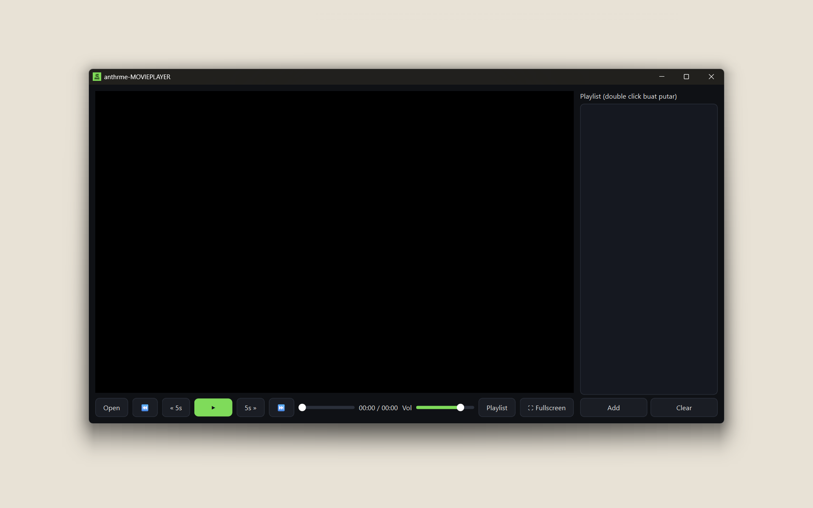
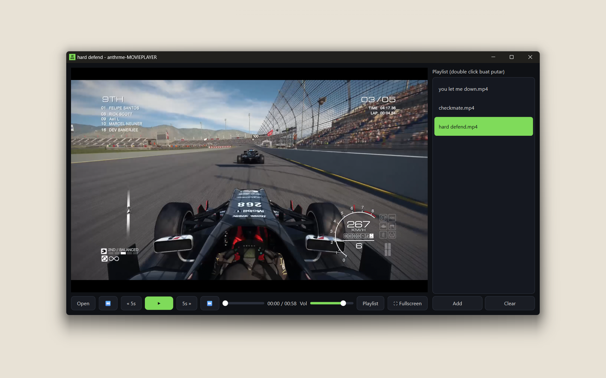
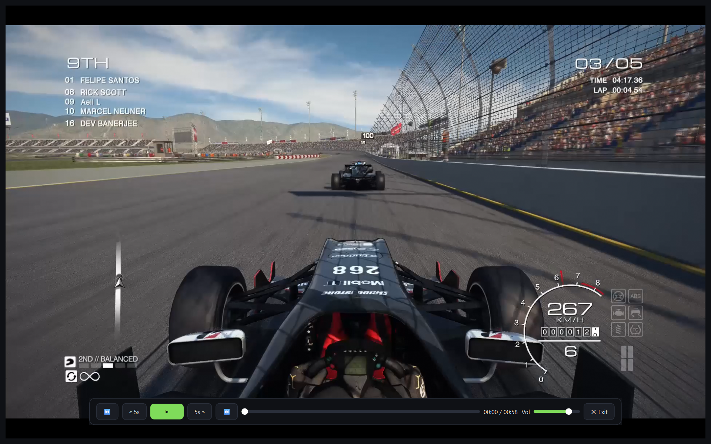
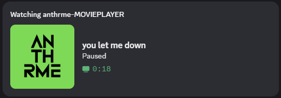

# anthrme-MOVIEPLAYER

A lightweight desktop video player built with Python, powered by mpv, with live **Discord Rich Presence** that shows what you're watching.






## Features

- Playback via libmpv (mp4, mkv, avi, mov, webm, and more)
- Playlist with auto-play next, Prev/Next, drag & drop
- Resume from the last watched position
- Skip back/forward 5 seconds
- Fullscreen with on-screen controls that auto-hide
- Automatic subtitle loading (`.srt` with the same name as the video)
- Discord Rich Presence: title, progress, and play/pause status
- Custom dark theme
- Playback speed (0.5x to 2x), screenshots, audio track and subtitle selection
- "Open with" support: open videos straight from Windows Explorer

## Download (Windows)

Grab the latest build from the [Releases](../../releases) page. Extract the whole zip, keep all files together, and run `anthrme-MOVIEPLAYER.exe` from inside the folder.
Discord desktop must be open for Rich Presence to work.

## Run from source

```bash
git clone https://github.com/davrielle/anthrme-movieplayer.git
cd anthrme-movieplayer
python -m venv venv
venv\Scripts\activate
pip install -r requirements.txt
```

Download `libmpv` for Windows (`mpv-dev-x86_64-*.7z`) from
https://sourceforge.net/projects/mpv-player-windows/files/libmpv/ ,
rename `libmpv-2.dll` to `mpv-2.dll`, and place it next to `main.py`.

Create your own Discord application at https://discord.com/developers/applications,
then set `CLIENT_ID` (and your art asset key) in `discord_rpc.py`.

```bash
python main.py
```

## Build the .exe

```bash
pyinstaller --noconfirm --clean --noconsole --name "anthrme-MOVIEPLAYER" --icon icon.ico --add-binary "mpv-2.dll;." --add-data "icon.ico;." main.py
```

## Tech stack

Python, PySide6 (Qt), python-mpv / libmpv, pypresence, PyInstaller

## Keyboard shortcuts

| Key | Action |
|---|---|
| Space | Play / Pause |
| Left / Right | Seek 5 seconds |
| F or double click | Toggle fullscreen |
| Esc | Exit fullscreen |